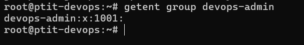
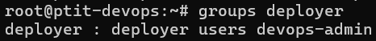
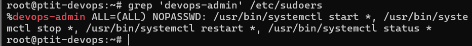
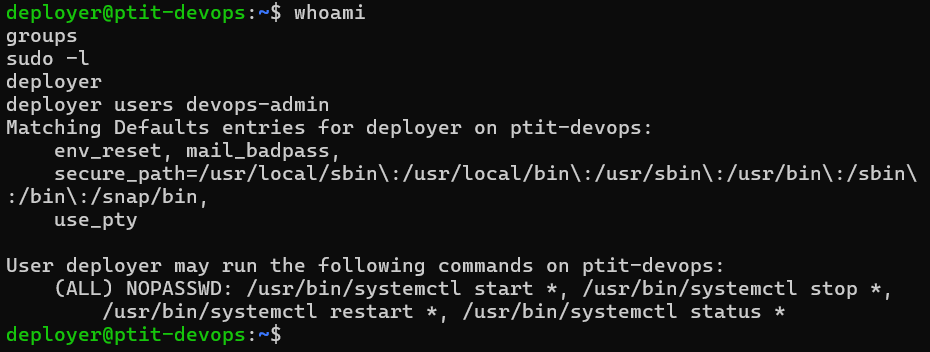
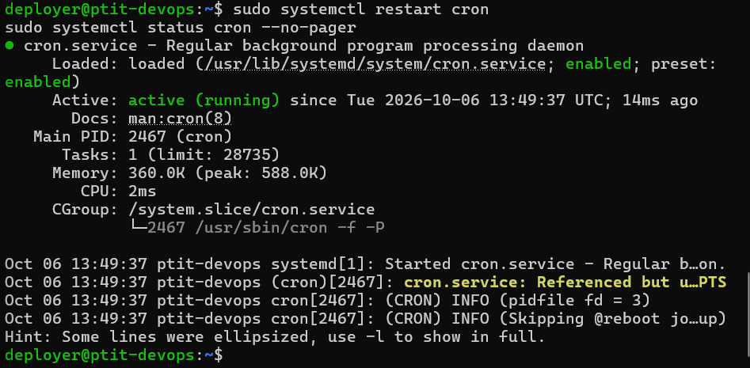

# Bài 2: Cấu hình phân quyền Nhóm và sudoers bằng visudo

## 1. Mục tiêu

- Tạo group `devops-admin`.
- Tạo user `deployer`.
- Thêm user `deployer` vào group `devops-admin`.
- Cấu hình `/etc/sudoers` bằng `visudo`.
- Cho phép group `devops-admin` thực hiện các lệnh `systemctl start`, `stop`, `restart`, `status` mà không cần nhập mật khẩu.

## 2. Tạo Group và User

### Tạo group

```bash
groupadd devops-admin
```

Kiểm tra:

```bash
getent group devops-admin
```

Kết quả:

```text
devops-admin:x:1001:deployer
```

### Tạo user

```bash
adduser deployer
```

### Thêm user vào group

```bash
usermod -aG devops-admin deployer
```

Kiểm tra:

```bash
groups deployer
```

Kết quả:

```text
deployer : deployer users devops-admin
```

## 3. Cấu hình sudoers

Mở file sudoers bằng `visudo`:

```bash
visudo
```

Thêm dòng:

```text
%devops-admin ALL=(ALL) NOPASSWD: /usr/bin/systemctl start *, /usr/bin/systemctl stop *, /usr/bin/systemctl restart *, /usr/bin/systemctl status *
```

### Ý nghĩa

- `%devops-admin`: áp dụng quyền cho tất cả user thuộc group `devops-admin`.
- `ALL=(ALL)`: cho phép chạy lệnh với quyền của user khác.
- `NOPASSWD`: không yêu cầu nhập mật khẩu.
- Chỉ cho phép các thao tác `systemctl start`, `stop`, `restart`, `status`.

Kiểm tra cấu hình:

```bash
grep 'devops-admin' /etc/sudoers
```

Kết quả:

```text
%devops-admin ALL=(ALL) NOPASSWD: /usr/bin/systemctl start *, /usr/bin/systemctl stop *, /usr/bin/systemctl restart *, /usr/bin/systemctl status *
```

## 4. Kiểm tra bằng user deployer

Chuyển sang user:

```bash
su - deployer
```

Kiểm tra user:

```bash
whoami
```

Kết quả:

```text
deployer
```

Kiểm tra group:

```bash
groups
```

Kết quả:

```text
deployer users devops-admin
```

## 5. Kiểm tra quyền sudo

Thực hiện:

```bash
sudo -l
```

Kết quả:

```text
User deployer may run the following commands on ptit-devops:
    (ALL) NOPASSWD: /usr/bin/systemctl start *, /usr/bin/systemctl stop *,
        /usr/bin/systemctl restart *, /usr/bin/systemctl status *
```

Như vậy user `deployer` không được cấp toàn quyền root mà chỉ được phép thực hiện các lệnh `systemctl` được quy định.

## 6. Kiểm tra restart service

Thực hiện:

```bash
sudo systemctl restart cron
```

Lệnh thực hiện thành công mà không yêu cầu nhập mật khẩu.

Kiểm tra trạng thái:

```bash
sudo systemctl status cron --no-pager
```

Kết quả:

```text
● cron.service - Regular background program processing daemon
     Loaded: loaded (/usr/lib/systemd/system/cron.service; enabled; preset: enabled)
     Active: active (running)
```

## 7. Kết luận

Đã hoàn thành yêu cầu bài tập:

- Tạo group `devops-admin`.
- Tạo user `deployer`.
- Thêm `deployer` vào `devops-admin`.
- Cấu hình sudoers bằng `visudo`.
- Group `devops-admin` được phép thực hiện `systemctl start`, `stop`, `restart`, `status` bằng `sudo` mà không cần nhập mật khẩu.
- Đã kiểm tra thành công quyền `restart` đối với `cron.service`.

## 8. Minh chứng

### 8.1. Group và user

Ảnh chụp kết quả:

```bash
getent group devops-admin
groups deployer
```




### 8.2. Cấu hình sudoers

Ảnh chụp kết quả:

```bash
grep 'devops-admin' /etc/sudoers
```

## 

### 8.3. Kiểm tra quyền sudo

Ảnh chụp kết quả khi đăng nhập bằng `deployer`:

```bash
whoami
groups
sudo -l
```



### 8.4. Kiểm tra restart service

Ảnh chụp kết quả:

```bash
sudo systemctl restart cron
sudo systemctl status cron --no-pager
```


